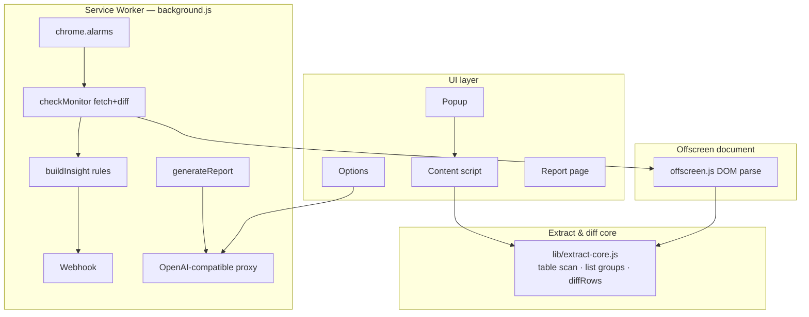

<div align="center">

# WebPilot AI · Web Data Assistant

**Know what changed. Know why it matters.**

**[简体中文](README.md)** · **English**

A **Chrome extension for competitor intelligence** built for SaaS founders and growth teams: extract structured data from public pricing pages and feature matrices, monitor **field-level** changes, and get actionable insights when rivals raise prices, change plans, or ship new features.

[](https://developer.chrome.com/docs/extensions/mv3/)
[](./manifest.json)
[]()
[](https://github.com/yimaomao-max/webpilot-chrome-extension)

[Quick start](#-quick-start) · [Features](#-core-features) · [Architecture](#-system-architecture) · [Webhooks](#-webhook-notifications) · [Compliance](#-scope--compliance)

</div>

---

## Sound familiar?

| Pain | WebPilot’s approach |
|------|---------------------|
| A competitor quietly raised prices—you heard it from a customer | **Row- and column-level diff** on pricing fields; `price_increase` / `price_decrease` |
| Feature pages get redesigned; old monitors only say “page changed” | **Stable field IDs + name anchoring**—comparable history even when column order shifts |
| You manually open 10 competitor URLs every week | **`chrome.alarms`** + anonymous fetch + **Offscreen DOM** parsing in the background |
| The team can’t tell if a change matters | **Rules-first insight engine**: categories (pricing / features / hiring / content), magnitude, evidence-backed hypotheses |
| Intel lives only in the browser | **Weekly Markdown reports**, **CSV / Excel / JSON**, **Feishu / DingTalk / Slack / WeCom webhooks** |

> In one line: turn “watching competitor public pages” into a **structured, replayable, push-ready** intelligence pipeline.

---

## Core features

### 1 · No-code pick & extract

- **Smart pick**: Click a row or block on the page to auto-generate CSS selectors and an extract config (table mode or repeated-list mode).
- **Scan tables**: Discover candidate `<table>` elements, ranked by completeness and column count.
- **Monitor from URL**: Paste a competitor link in the popup; scan tables remotely and create a monitor without opening the page first.

### 2 · Field model (comparable history)

1. Rule-based column types first (price, date, email, title, …); optional **AI field labeling** (OpenAI-compatible API).
2. After **Confirm fields**, each column gets a stable `id`; diffs align on **semantic fields**, not DOM indices.
3. If ≥60% of headers still match after renames, columns remap automatically. Major restructures set `needsReconfigure` / `selector_broken`—**never silently report “no change”** when selectors break.

### 3 · Three-stage monitor pipeline (LLM cost control)

```
Scheduled check ──► ① Pure DOM extract (extract-core + offscreen)
                ──► ② Field-level diff + rule insights (0 LLM calls)
                ──► ③ Optional LLM only on “AI interpret” or weekly report
```

Routine checks use **zero LLM calls per run**; quality comes from `diffRows`, price delta math, and `buildInsight`.

### 4 · Changes as intelligence

- **Summaries**: e.g. `Pro $29 → $39`, sample added/removed rows.
- **Structured `field_changes[]`** with `change_type` (`price_increase`, `row_added`, …).
- **Insight cards**: facts + hypothesis with evidence (e.g. price up + new rows → possible tiering).
- **Toolbar badge**: `!` (meaningful change) / `⚠` (selector broken).

### 5 · Export & collaboration

| Capability | Description |
|--------------|-------------|
| Paginated batch extract | Follow “next page” links across navigations, up to 200 pages (be kind to target sites) |
| CSV / Excel / JSON | One-click export from the popup |
| Weekly report | Grouped by **competitor domain**; on-demand or scheduled |
| Webhook | POST on meaningful changes; adapters for Feishu, DingTalk, WeCom, Slack |

### 6 · Plans & cloud pairing (optional)

Simulate **Free / Pro / Team** quotas locally. When paired with WebPilot cloud, **`serverPlan`** from the server overrides limits (monitor count, min interval, history retention).

---

## System architecture



### Module map

| Path | Role |
|------|------|
| `manifest.json` | MV3: `activeTab`, `scripting`, `storage`, `alarms`, `offscreen` |
| `content.js` | Pick mode, pagination job, popup bridge |
| `background.js` | Scheduling, diff, insights, webhooks, reports, LLM |
| `offscreen.js` | Parse fetched HTML in a headless document (shared extract-core) |
| `lib/extract-core.js` | **Zero-dep** extract / align / diff kernel |
| `popup/` | Preview, field confirm, monitors, export |
| `options/` | API key, cloud pairing, webhook, plan |
| `report.html` | Weekly report UI |

### Storage keys (debugging)

| Key | Contents |
|-----|----------|
| `wp_settings` | API, webhook, plan, cloud bind |
| `wp_draft` | Current extract draft |
| `wp_monitors` | Monitor defs + latest snapshot |
| `wp_changes` | Change history (up to 20 per monitor) |
| `wp_paginationJob` | Cross-page batch job state |

---

## Quick start

### Install (developer)

1. Clone: `git clone https://github.com/yimaomao-max/webpilot-chrome-extension.git`
2. Chrome → `chrome://extensions` → enable **Developer mode**
3. **Load unpacked** → select the repo root (folder with `manifest.json`)
4. Pin the extension to the toolbar

### Typical workflow (~3 minutes)

```text
Open a competitor’s public pricing page
    ↓
Extension → “Smart pick” or “Scan tables”
    ↓
Preview → (optional) AI fields → “Confirm fields”
    ↓
Pick check interval → “Save as monitor”
    ↓
(Optional) Options → Webhook → pushes to Slack / Feishu / etc.
    ↓
Weekly: “Generate report now” or wait for badge / webhook
```

### AI setup (optional)

Open **Settings** (gear in the popup):

| Field | Example |
|-------|---------|
| API Base URL | `https://api.openai.com/v1`, DeepSeek, Qwen, Ollama-compatible endpoints |
| API Key | Stored in `chrome.storage.local` only |
| Model | Default `gpt-4o-mini` |

Without a key: **rule-based fields + full monitoring diff + rule insights** still work.

### Cloud pairing (optional)

1. Get pairing code `wpk_...` from the WebPilot SaaS dashboard  
2. Options → cloud base URL + code → **Bind / refresh plan**  
3. Unbind falls back to local simulated plans  

---

## Plans (local simulation)

> Production limits follow cloud `serverPlan`; this table matches the Options dropdown for self-testing.

| Plan | Max monitors | Min interval | History | Highlights |
|------|--------------|--------------|---------|------------|
| **Free** | 3 | 24 h | 7 days | CSV export |
| **Pro** | 30 | 1 h | 90 days | AI change analysis, tighter checks |
| **Team** | 100 | 30 min | 365 days | Collaboration & sync (roadmap) |

Quota usage appears in the popup header before you create monitors.

---

## Webhook notifications

Set a bot URL in Options. On **meaningful change**, WebPilot `POST`s JSON (or IM-friendly text).

### Built-in IM adapters

| Platform | Host hint | Payload |
|----------|-----------|---------|
| Feishu / Lark | `feishu` / `larksuite` | `msg_type: text` |
| DingTalk | `dingtalk` | `msgtype: text` |
| WeCom | `qyapi.weixin` | `msgtype: text` |
| Slack | `slack` | `{ "text": "..." }` |
| Custom | any other URL | full structured JSON |

### Custom receiver JSON example

```json
{
  "event": "webpilot.change",
  "monitor": "Notion Pricing",
  "pageUrl": "https://example.com/pricing",
  "time": 1731859200000,
  "summary": ["Pro $8 → $10", "1 row added …"],
  "insight": {
    "category": ["pricing"],
    "facts": ["Price increased 25%: …"],
    "guess": ["A 25% increase may indicate…"]
  },
  "oldCount": 12,
  "newCount": 13
}
```

Use **Test webhook** in Options (`webpilot.test` event).

---

## Scope & compliance

WebPilot is for extraction and change monitoring on **public pages you explicitly choose**.

- Checks use **anonymous `fetch`** (`credentials: 'omit'`); not a login bypass.
- **No** captcha, paywall, or access-control circumvention.
- Keys, webhooks, and captured data stay **on-device** by default—do not commit secrets to Git.
- Respect site terms, reasonable crawling etiquette, and applicable law; not for bulk personal-data harvesting.

---

## Development

### Requirements

- Google Chrome 109+ (Offscreen Documents)  
- No Node.js required to load the extension  

### Debugging

| Scenario | How |
|----------|-----|
| Service worker logs | `chrome://extensions` → WebPilot → **Service worker** |
| Content script | Page DevTools → Console |
| Storage | DevTools → Application → Extension storage |
| Manual check | Call `checkMonitor(id)` in `background.js` |

### Chrome Web Store zip

```bash
zip -r webpilot-v0.2.0.zip . -x "*.git*"
```

Prepare store assets and privacy copy before submission.

---

## Roadmap

- [ ] Deeper WebPilot SaaS sync (cloud history, team sharing)  
- [ ] Google Sheets one-way sync (Team)  
- [ ] Better pick guidance for SPAs / lazy-loaded pages  
- [ ] Open-source LICENSE and contributing guide  

Feedback: [Issues](https://github.com/yimaomao-max/webpilot-chrome-extension/issues).

---

## Related repos

This repo is the **browser extension**. The Web SaaS (accounts, pairing, server-side monitors) is typically hosted in a separate repo (e.g. Vercel).

**Detailed manual:** [docs/USER_GUIDE.en.md](docs/USER_GUIDE.en.md) · Chinese: [docs/USER_GUIDE.md](docs/USER_GUIDE.md)

---

<div align="center">

**WebPilot AI** — Competitor Data Intelligence  
Made for founders who hate surprises on pricing pages.

</div>