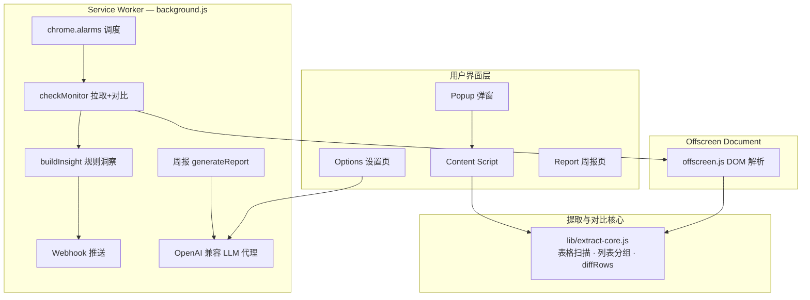

<div align="center">

# WebPilot AI · 网页数据助手

**Know what changed. Know why it matters.**

**[简体中文](README.md)** · **[English](README.en.md)**

面向 SaaS 创始人与增长团队的 **Chrome 竞争对手情报扩展**：从公开定价页、功能对比表提取结构化数据，持续监控字段级变化，在涨价、改套餐、上新功能时第一时间收到可行动的洞察。

[](https://developer.chrome.com/docs/extensions/mv3/)
[](./manifest.json)
[]()
[](https://github.com/yimaomao-max/webpilot-chrome-extension)

[快速开始](#-快速开始) · [核心能力](#-核心能力) · [架构](#-系统架构) · [Webhook](#-webhook-推送) · [合规](#-使用边界与合规)

</div>

---

## 你是否遇到过这些场景？

| 痛点 | WebPilot 的做法 |
|------|-----------------|
| 竞品悄悄涨价，你从客户嘴里才知道 | 对定价表字段做 **行级 + 列级 diff**，识别 `price_increase` / `price_decrease` |
| 功能页一改版，旧监控工具只会报「页面变了」 | **稳定字段 ID + 名称锚点对齐**，列顺序变了仍能可比 |
| 只能人肉每周打开 10 个竞品页 | **chrome.alarms 定时匿名拉取** + Offscreen DOM 解析，后台持续跑 |
| 团队不知道「这条变化重不重要」 | **规则洞察引擎**：分类（价格/功能/招聘/内容）+ 幅度 + 可验证推断 |
| 情报散落在浏览器里 | **周报 Markdown**、**CSV / Excel / JSON**、**飞书 / 钉钉 / Slack Webhook** |

> 一句话：**把「盯竞品公开页」从体力活，变成结构化、可回放、可推送的情报流水线。**

---

## 核心能力

### 1 · 零代码拾取提取

- **智能选择提取**：在页面上点选一行/一块，自动生成 CSS 选择器与提取配置（表格模式 or 列表分组模式）。
- **扫描页面表格**：自动发现文档内候选 `<table>`，按完整度与列数排序供你选择。
- **从 URL 添加监控**：在弹窗粘贴竞品链接，远程扫描表格后直接创建监控任务。

### 2 · 字段体系（历史可比性的根基）

1. 规则优先识别列类型（价格、日期、邮箱、标题…）；可选 **AI 识别字段**（OpenAI 兼容 API）。
2. 用户 **确认字段** 后，每列获得稳定 `id`，监控对比按「字段语义」而非「DOM 下标」对齐。
3. 当表头改名但 ≥60% 列仍能匹配时，自动映射到新表头；结构巨变时标记 `needsReconfigure` / `selector_broken`，**绝不静默误报「无变化」**。

### 3 · 三级监控流水线（AI 成本控制）

```
定时检查 ──► ① 纯 DOM 提取（extract-core + offscreen）
         ──► ② 字段级 diff + 规则洞察（0 次 LLM）
         ──► ③ 仅在「用户点 AI 解读」或「生成周报」时可选调用 LLM
```

例行监控 **每次检查 LLM 调用数 = 0**；情报质量由 `diffRows`、价格幅度计算、`buildInsight` 规则层保障。

### 4 · 变化即情报

- **摘要**：`「专业版」 $29 → $39`、新增/移除行样本等。
- **结构化记录**：`field_changes[]` 含 `change_type`（如 `price_increase`、`row_added`）。
- **洞察卡片**：事实列表 + 带证据的「初步推断」（如提价同时增行 → 可能产品分层调整）。
- **角标提醒**：Toolbar Badge `!`（有变化）/ `⚠`（选择器失效）。

### 5 · 导出与协同

| 能力 | 说明 |
|------|------|
| 批量分页提取 | 自动识别「下一页」，跨导航累计最多 200 页（请尊重站点负载） |
| CSV / Excel / JSON | 弹窗一键导出当前预览或采集结果 |
| 每周报告 | 按 **竞争对手域名** 聚合；支持立即生成 + 定时周报 |
| Webhook | 有意义变化时 POST；内置飞书 / 钉钉 / 企业微信 / Slack 文本格式适配 |

### 6 · 套餐与云端绑定（可选）

本地可模拟 **Free / Pro / Team** 配额；绑定 WebPilot 云端后，**服务端下发的 `serverPlan`** 覆盖本地限额（监控数、最小间隔、历史保留天数）。

---

## 系统架构



### 模块一览

| 文件 / 目录 | 职责 |
|-------------|------|
| `manifest.json` | MV3 权限：`activeTab` `scripting` `storage` `alarms` `offscreen` |
| `content.js` | 拾取模式、分页批采、与 Popup 消息桥 |
| `background.js` | 监控调度、diff、洞察、Webhook、周报、LLM |
| `offscreen.js` | 在无头文档中解析 `fetch` 回的 HTML（与 content 共享 extract-core） |
| `lib/extract-core.js` | **零依赖** 提取 / 对齐 / diff 内核 |
| `popup/` | 提取预览、字段确认、监控列表、导出 |
| `options/` | API Key、云端配对、Webhook、套餐 |
| `report.html` | 周报阅读与导出 |

### 本地存储键（调试参考）

| Key | 内容 |
|-----|------|
| `wp_settings` | API、Webhook、套餐、云端绑定 |
| `wp_draft` | 当前提取草稿 |
| `wp_monitors` | 监控任务定义与最近快照 |
| `wp_changes` | 各监控的变化历史（最多保留 20 条/任务） |
| `wp_paginationJob` | 跨页批采任务状态 |

---

## 快速开始

### 安装（开发者）

1. 克隆仓库  
   `git clone https://github.com/yimaomao-max/webpilot-chrome-extension.git`
2. Chrome 打开 `chrome://extensions` → 开启 **开发者模式**
3. **加载已解压的扩展程序** → 选择仓库根目录（含 `manifest.json`）
4. 固定扩展图标到工具栏

### 典型工作流（3 分钟）

```text
打开竞品公开定价页
    ↓
点击扩展 →「智能选择提取」或「扫描页面表格」
    ↓
预览数据 →（可选）AI 识别字段 →「确认字段」
    ↓
选择检查间隔 →「保存为监控任务」
    ↓
（可选）设置页填写 Webhook → 变化自动推送到飞书/钉钉
    ↓
每周点击「立即生成本周报告」或将来看 Badge / Webhook 通知
```

### AI 配置（可选）

打开 **扩展设置**（弹窗右上角齿轮）：

| 字段 | 示例 |
|------|------|
| API Base URL | `https://api.openai.com/v1` 或 DeepSeek / 通义 / Ollama 兼容地址 |
| API Key | 仅存于 `chrome.storage.local`，不上传云端 |
| 模型 | 默认 `gpt-4o-mini` |

不配置 Key 时：**规则字段识别 + 全套监控 diff + 规则洞察** 仍完全可用。

### 云端配对（可选）

1. 在 WebPilot SaaS 仪表盘获取 **配对码** `wpk_...`
2. 设置页填写 **云端 Base URL** + 配对码 → **绑定 / 刷新套餐**
3. 解绑后回退到本地模拟套餐

---

## 套餐对照（本地模拟）

> 正式商业化以云端 `serverPlan` 为准；下表与设置页选项一致，便于自测。

| 套餐 | 监控页面上限 | 最短检查间隔 | 历史保留 | 亮点 |
|------|-------------|--------------|----------|------|
| **Free** | 3 | 24 h | 7 天 | CSV 导出 |
| **Pro** | 30 | 1 h | 90 天 | AI 变化分析、更密检查 |
| **Team** | 100 | 30 min | 365 天 | 协作与同步能力（产品规划） |

创建监控前，Popup 右上角 **quota** 会显示当前用量。

---

## Webhook 推送

在设置页填写机器人地址。检测到 **有意义变化** 时 `POST` JSON。

### 内置 IM 适配

| 平台 | 识别方式 | 载荷 |
|------|----------|------|
| 飞书 / Lark | `feishu` / `larksuite` host | `msg_type: text` |
| 钉钉 | `dingtalk` host | `msgtype: text` |
| 企业微信 | `qyapi.weixin` host | `msgtype: text` |
| Slack | `slack` host | `{ "text": "..." }` |
| 自定义 | 其他 URL | 完整结构化 JSON |

### 自定义接收端 JSON 示例

```json
{
  "event": "webpilot.change",
  "monitor": "Notion Pricing",
  "pageUrl": "https://example.com/pricing",
  "time": 1731859200000,
  "summary": ["「专业版」 $8 → $10", "新增 1 条 …"],
  "insight": {
    "category": ["价格/套餐"],
    "facts": ["价格上涨 25%：…"],
    "guess": ["价格上涨 25%，可能意味着…"]
  },
  "oldCount": 12,
  "newCount": 13
}
```

设置页提供 **测试 Webhook** 按钮，事件类型为 `webpilot.test`。

---

## 使用边界与合规

WebPilot AI **只设计用于你明确选择的公开网页**上的数据提取与变化监控。

- 监控检查以 **匿名 `fetch`（`credentials: 'omit'`）** 访问页面，不代替用户登录。
- **不包含** 绕过验证码、付费墙、登录态或访问控制的机制。
- API Key、Webhook、采集结果默认保存在 **本机浏览器**；请勿将含密钥的配置提交到 Git。
- 请遵守目标网站服务条款、robots 合理使用习惯及当地法律法规；勿用于大规模个人信息采集。

---

## 开发指南

### 环境要求

- Google Chrome 109+（支持 Offscreen Documents）
- 无需 Node.js 即可加载扩展；若你 fork 后增加构建链，可自行添加

### 调试技巧

| 场景 | 操作 |
|------|------|
| Service Worker 日志 | `chrome://extensions` → WebPilot → **Service Worker** |
| Content Script | 目标页 DevTools → Console（过滤 `webpilot`） |
| 存储状态 | DevTools → Application → Extension storage |
| 手动触发检查 | 在 `background.js` 对指定 monitor id 调用 `checkMonitor` |

### 发布包（Chrome Web Store）

```bash
# 在仓库根目录打包（排除 .git）
zip -r webpilot-v0.2.0.zip . -x "*.git*"
```

上架前请自备商店素材与隐私政策说明（可参考产品文档中的 CWS Listing 要点）。

---

## 路线图（社区可见）

- [ ] 与 WebPilot SaaS 深度同步（云端历史、团队共享）
- [ ] Google Sheets 单向同步（Team 套餐）
- [ ] 更强 SPA / 懒加载页面的拾取引导
- [ ] 开源 LICENSE 与贡献者指南

欢迎通过 [Issues](https://github.com/yimaomao-max/webpilot-chrome-extension/issues) 反馈需求与 Bug。

---

## 相关仓库

本仓库为 **浏览器端扩展**。配套 Web SaaS（账户、配对、服务端监控）可单独部署；若你的 monorepo 中包含 `web-saas`，通常以第二个 GitHub 仓库托管并连接 Vercel。

**详细手册：** [docs/USER_GUIDE.md](docs/USER_GUIDE.md) · English: [docs/USER_GUIDE.en.md](docs/USER_GUIDE.en.md)

---

## Star History

如果 WebPilot 帮你省下了一周又一次人肉刷竞品页的时间，欢迎 **Star ⭐** 支持项目持续迭代。

---

<div align="center">

**WebPilot AI** — Competitor Data Intelligence  
Made for founders who hate surprises on pricing pages.

</div>